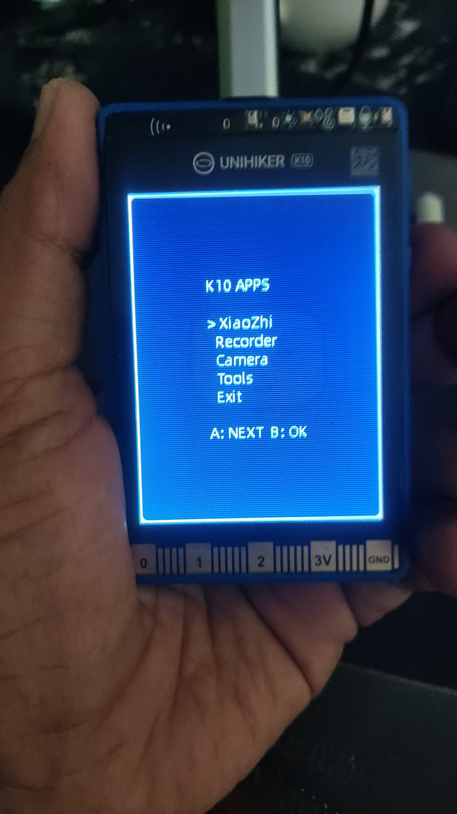
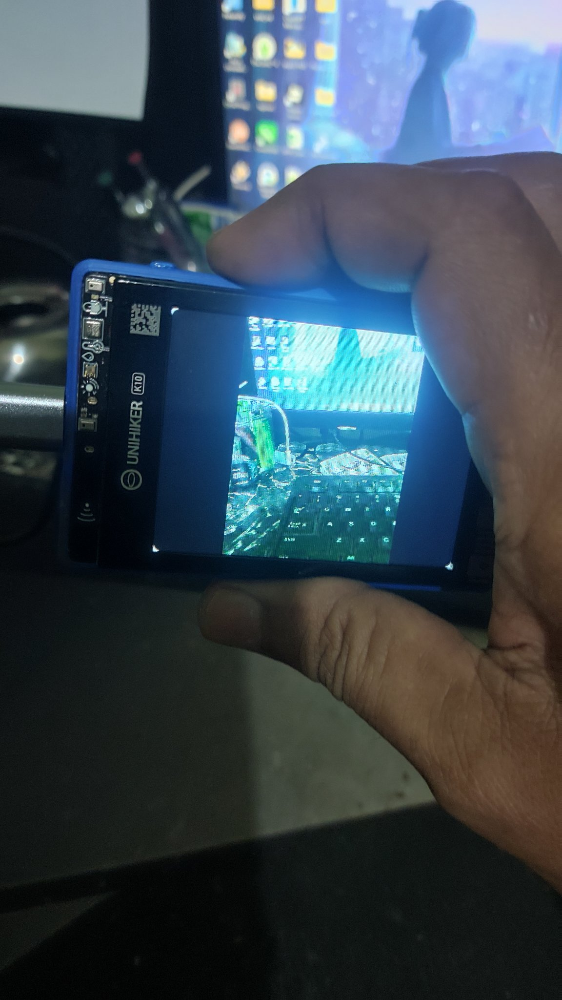
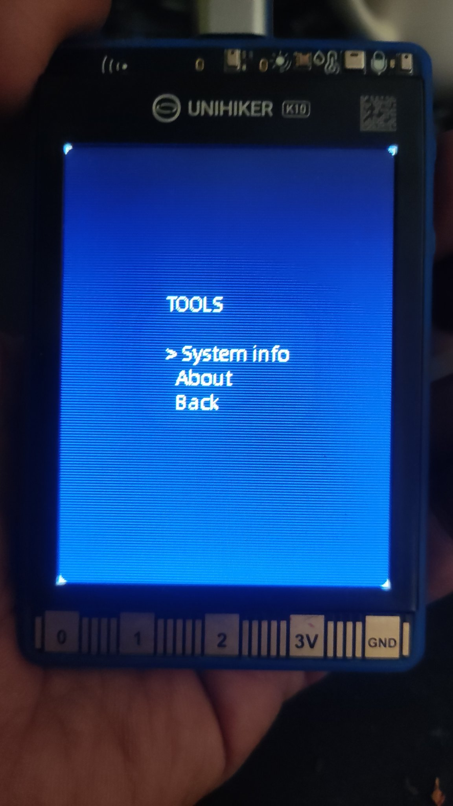
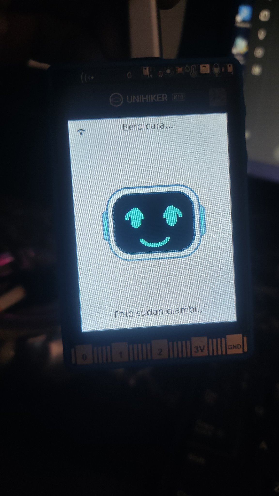

# K10-Genius — Firmware Genius untuk UNIHIKER K10

Firmware **Genius** untuk **DFRobot UNIHIKER K10** — fork dari
[78/xiaozhi-esp32](https://github.com/78/xiaozhi-esp32) dengan `GeniusV2Client`:
K10 berbicara ke backend Genius V3 (custom Python server), bukan ke server
xiaozhi standar. Ini adalah **daily driver** K10.

> README ini menggantikan README generik upstream — isinya spesifik firmware
> Genius di board df-k10.

## Foto

 
*K10 APPS launcher (kiri) — Camera App dengan live preview (kanan)*

 
*Menu Tools (kiri) — Genius "Berbicara…" setelah ambil foto (kanan)*

## Hardware (df-k10)

| Item | Nilai |
|---|---|
| Board | DFRobot UNIHIKER K10 |
| Chip | ESP32-S3N16R8 (16 MB flash, 8 MB octal PSRAM) |
| LCD | ILI9341 240×320 |
| Audio | I2S0: MCLK 3, BCLK 0, WS 38, DOUT 45, DIN 39 — **24 kHz** |
| Speaker | Raw I2S TX (ES8311 **tidak** di-init via I2C — tidak menjawab @0x18) |
| Mic | ES7210 @0x23, RX TDM mode, gain digital x4 (chipmunk-pitch fixed) |
| Kamera | GC2145 — **standalone app**, tidak pernah digabung dengan Alexa vision |
| SD card | SPI2 dedicated: SCLK 44, MISO 41, MOSI 42, CS 40 |
| Tombol | A / B via expander TCA9555 |

## Aplikasi (K10 APPS launcher)

Tombol **A: NEXT, B: OK**.

| App | Fungsi |
|---|---|
| XiaoZhi | Voice chat ke backend Genius (wake word + PTT) |
| Recorder | Rekam WAV ke SD card, hapus 2-tahap (request → confirm) |
| Camera | Live preview + ambil foto, standalone |
| Tools | System info, About |
| Exit | Keluar launcher |

## Fitur Genius

- 🎙️ Voice interaction (wake word "xiao zhi" + tombol PTT)
- 📻 Radio & musik YouTube streaming via backend Genius
- ⏰ Alarm native (`self.alarm.*`)
- ⚠️ EWS — status & cek peringatan dini (`self.ews.*`)
- 📷 Alexa Vision — kamera on-demand untuk analisis gambar
- 🔊 Media tools native: `self.media.play_url`, `self.media.stop`

## Pekerjaan berjalan

- **Perbaikan SRAM** (branch `feature/k10-sdcard-mcp`): lazy camera init, deinit
  kamera setelah Alexa Vision, buffer DMA kamera dikecilkan ke 16384.
  Akar masalah: SRAM bebas ~15 KB saat streaming → `esp-aes` gagal alokasi
  saat TLS read → reconnect loop tiap ~4–6 detik (radio putus-putus).
- Aturan kamera: **standalone**, lifecycle tidak pernah digabung dengan Alexa vision.

## Build & flash

Workspace: `D:\ESP-PROJECTS\ACTIVE\k10` · Toolchain: **ESP-IDF 6.1**

```bat
idf.py --config k10-user.json --language id-ID build
```

Flash **app-only** (NVS/WiFi awet):

```bat
esptool --port COM14 write_flash 0x20000 build\xiaozhi.bin
```

> Ganti `COM14` dengan port K10 masing-masing (port bisa berubah setelah replug).
> Jangan flash merged-binary penuh — NVS ikut terhapus.

## Struktur repo

| Path | Isi |
|---|---|
| `main/boards/dfrobot/df-k10/` | Board support: `df_k10_board.cc`, `k10_audio_codec.cc`, `k10_launcher.h`, `k10_recorder.h`, `k10_legacy_camera.cc` |
| `main/genius/` | `genius_v2_client.cc`, `command_handler.cc`, `native_services.cc`, `tools.cc`, `media_decoder.cc`, portal |
| `main/mcp_server.cc` | MCP server (tools native + bridge ke backend) |
| `docs/img/` | Foto hardware |

## Referensi

- Upstream: [78/xiaozhi-esp32](https://github.com/78/xiaozhi-esp32)
- Backend: Genius V3 (server pribadi)
